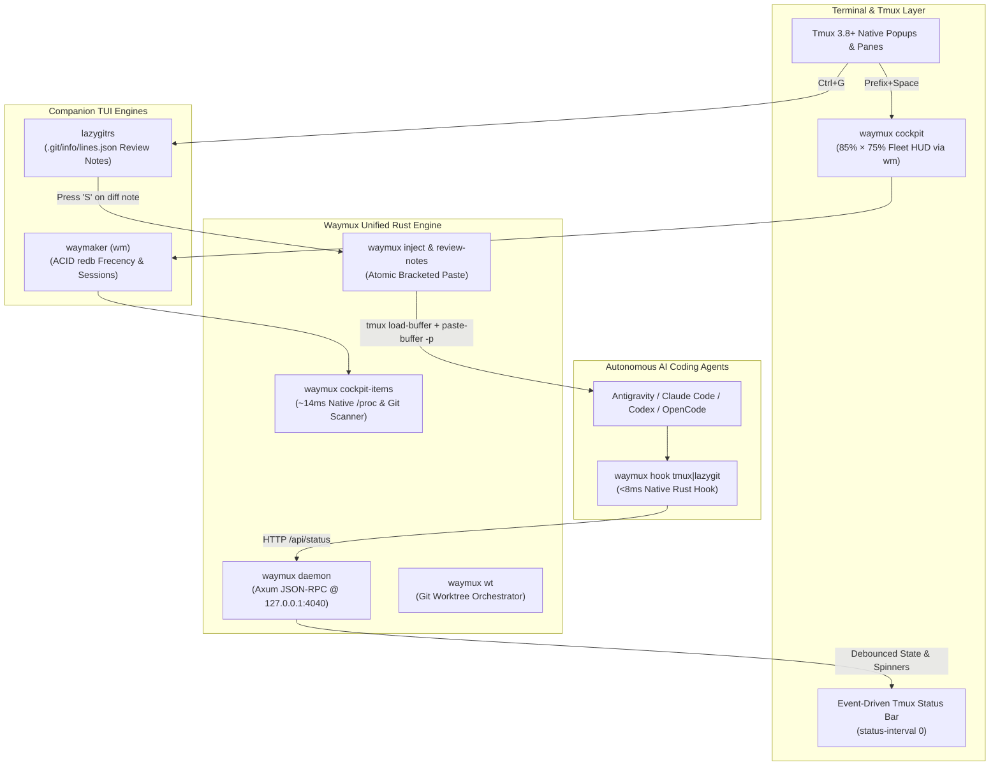

<div align="center">


# Waymux

### Autonomous Terminal AI Cockpit & Control Plane Daemon
**Sub-1.5ms CLI Fast-Path · 0% Idle CPU · Biomechanical Keyboard Ergonomics ($H=0$)**

[](https://github.com/felipecm-br/waymux/releases)
[](LICENSE)
[](#)

</div>

---

## ⚡ Why Waymux? (The Problem & The Solution)

Running multiple autonomous AI coding agents (`agy`, `claude`, `codex`, `opencode`, `crush`) inside Tmux typically degrades terminal ergonomics:
1. **Status Bar Flicker & Polling Drain**: Rapid tool chaining causes 10+ state flips per second, while `status-interval 1` polling scripts drain CPU and battery when idle.
2. **Cold-Start Hook & Shell Latency**: Spawning Node.js or Python scripts on every `PreToolUse` / `PostToolUse` hook adds 40–60ms of latency per tool call, and `/proc` shell loops (`ps` + `awk` + `jq`) take 140ms+ to render window pickers.
3. **Disjointed Code Review & Worktree Contexts**: Sending inline diff review notes from Git TUIs (`lazygitrs`) into an active agent pane without tearing multi-line markdown, or managing 1-worktree-per-session sandboxes, usually requires fragile shell glue.

**Waymux solves all of this in a single ~5 MB static Rust binary:**
- **0% Idle CPU (`status-interval 0`)**: An asynchronous Axum/Tokio daemon (`waymux daemon`) tracks agent states with consolidated 300ms idle debouncing, proactive stall detection (20s hung-agent heuristic), and multi-pane urgency aggregation.
- **<1.5ms Synchronous CLI Fast-Path**: All client subcommands (`cockpit`, `triage`, `hook`, `inject`, `wt`, `dismiss`, `status`, `list`) execute synchronously **before** initializing the Tokio runtime.
- **~14ms Native `/proc` Cockpit HUD**: Scans `/proc/<pid>/stat` and `/proc/<pid>/comm` directly in Rust to render a 12-column TUI fleet dashboard via **Waymaker (`wm`)** with embedded presets and live `delta` side-by-side diffs.
- **Zero-Node Agent Hooks & Bracketed-Paste Injection**: Native `waymux hook {tmux|lazygit}` (~8ms) and `waymux inject` deliver multi-line review notes atomically via `tmux load-buffer` + `paste-buffer -p`.
- **Native Git Worktree Orchestrator (`waymux wt` / `awt`)**: Provisions sibling `.bare` worktrees, copies untracked `.env*` secrets, and binds 1 worktree to 1 Tmux session.

---

## 🚀 Quick Installation

### 1-Command Zero-Compile Install (Linux & macOS)

```bash
curl -fsSL https://raw.githubusercontent.com/felipecm-br/waymux/main/install.sh | bash
```

The installer downloads the pre-built static binary to `~/.local/bin/waymux` (and symlinks `~/.local/bin/acpd`), verifies its SHA-256 checksum, installs `~/.local/share/waymux/tmux/waymux.tmux`, and enables the user-level systemd service (`waymux.service`).

### Build from Source (Rust 1.85+)

```bash
git clone https://github.com/felipecm-br/waymux.git
cd waymux
./install.sh --from-source
```

---

## 🛠️ CLI Command Reference

All CLI commands bypass the async runtime for instant (`<1.5ms`) execution:

| Command | Description |
| :--- | :--- |
| `waymux daemon [--config <file>]` | Start the async JSON-RPC 2.0 & HTTP control plane daemon on `127.0.0.1:4040` |
| `waymux health` | Probe daemon health (`GET /health`) and exit `0` if healthy |
| `waymux status` | Print daemon health and all active AI agent pane states |
| `waymux list` | List active AI agent pane states in TSV format (`pane_id`, `state`, `last_timestamp`) |
| `waymux dismiss [pane_id]` | Dismiss attention/question/permission badge for a pane (used on `pane-focus-in`) |
| `waymux cockpit [--agents]` | Launch the `85% × 75%` AI Fleet & Window Cockpit HUD popup via Waymaker (`wm`) |
| `waymux cockpit-items [--agents]` | Emit prioritized 12-column TSV rows with native `/proc` CPU/RAM telemetry |
| `waymux cockpit-preview <s> <i> <p> [path]` | Render contextual agent metadata card, PR status, review notes, and pane snapshot |
| `waymux cockpit-diff <path> [pane_id]` | Render side-by-side Git diff (`delta` / `bat`) and pending review notes |
| `waymux cockpit-help` | Render telemetry HUD and ergonomic keybinding cheat-sheet |
| `waymux agent-action <act> <st> <pid> [pane]` | Execute guarded agent action (`approve`, `deny`, `prompt`) |
| `waymux review-notes <count\|list\|send> ...` | Count, list, or atomically send `.git/info/lines.json` review notes to an agent |
| `waymux triage --popup` | Cycle notifying AI agent panes inside an isolated `_popups` overlay |
| `waymux triage --jump` | Jump to the next agent waiting on you (permission → question → error/stalled, oldest first) with origin-return memory |
| `waymux hook <tmux\|lazygit> <Event>` | Zero-Node AI agent lifecycle hook (`PreInvocation`, `PreToolUse`, `PostToolUse`, `Stop`, `SessionEnd`) |
| `waymux inject <workspace_dir> <prompt>` | Inject multi-line prompt into active workspace agent pane via bracketed paste |
| `waymux wt <subcommand>` | Git worktree orchestrator (`new`, `go`, `ls`, `rm`, `ship`, `reap`, `sweep`, `pick`) |
| `waymux init <--tmux\|--systemd\|--hooks>` | Emit portable configuration snippets for `.tmux.conf`, systemd, and AI hooks |

---

## ⌨️ Tmux & AI Hook Integration

### 1. Load Plugin in `~/.tmux.conf`

```tmux
run-shell "~/.local/share/waymux/tmux/waymux.tmux"
```

Or bind directly:

```tmux
set -g status-interval 0
set-hook -g pane-focus-in 'run-shell -b "waymux dismiss #{pane_id} >/dev/null 2>&1 || true"'

bind-key Space if-shell -F '#{==:#{session_name},_popups}' 'detach-client' 'run-shell "waymux cockpit"'
bind-key "i"   if-shell -F '#{==:#{session_name},_popups}' 'detach-client' 'run-shell "waymux triage --popup"'
bind-key "I"   run-shell "waymux triage --jump"
bind-key -n 'C-S-i' run-shell "waymux triage --jump"
```

### 2. Antigravity / Claude Code Hooks (`hooks.json`)

```json
{
  "tmux": {
    "PreInvocation": [
      { "command": "waymux hook tmux PreInvocation", "timeout": 0, "type": "command" },
      { "command": "waymux hook lazygit PreInvocation", "timeout": 0, "type": "command" }
    ],
    "PreToolUse": [
      {
        "hooks": [{ "command": "waymux hook tmux PreToolUse", "timeout": 0, "type": "command" }],
        "matcher": "*"
      }
    ],
    "PostToolUse": [
      {
        "hooks": [{ "command": "waymux hook tmux PostToolUse", "timeout": 0, "type": "command" }],
        "matcher": "*"
      }
    ],
    "PostInvocation": [
      { "command": "waymux hook tmux PostInvocation", "timeout": 0, "type": "command" }
    ],
    "Stop": [
      { "command": "waymux hook tmux Stop", "timeout": 0, "type": "command" }
    ],
    "SessionEnd": [
      { "command": "waymux hook tmux SessionEnd", "timeout": 0, "type": "command" },
      { "command": "waymux hook lazygit SessionEnd", "timeout": 0, "type": "command" }
    ]
  }
}
```

---

## 🏛️ Architecture & Ecosystem



---

## 🔌 JSON-RPC 2.0 Control Plane (`127.0.0.1:4040`)

`waymux daemon` runs out-of-the-box with built-in defaults (`127.0.0.1:4040`, 300ms idle debounce) and optionally loads `~/.config/waymux/config.toml`.

Protected endpoints authenticate via local Bearer token stored at `$XDG_RUNTIME_DIR/waymux/token` (`0600` permissions):

- **`POST /rpc`**: JSON-RPC 2.0 endpoint supporting:
  - `agentState/update`, `agentState/list`, `agentState/dismiss`, `agentState/wait`
  - `tmux.new_window`, `tmux.select_window`, `tmux.kill_window`, `tmux.list_windows`
  - `tmux.split_pane`, `tmux.select_pane`, `tmux.kill_pane`, `tmux.list_panes`, `tmux.capture_pane`, `tmux.send_keys`, `tmux.select_layout`
  - `tmux.new_session`, `tmux.kill_session`, `tmux.list_sessions`
  - `tmux.display_message`, `tmux.ring_bell`
- **`POST /api/status`**: REST endpoint for direct agent state updates (`working`, `idle`, `awaiting_input`, `question`, `permission`, `stalled`, `error`, `closed`).
- **`GET /health` & `GET /ready`**: Liveness and readiness probes.

---

## 🧪 Development & Verification

```bash
# Format, lint (zero warnings), and run all 30 unit tests
cargo fmt --all -- --check
cargo clippy --all-targets --all-features -- -D warnings
cargo test

# Rebuild release binary and restart user systemd service
./scripts/update-daemon.sh
```

### 🐳 Isolated Docker Sandbox

Test the complete Waymux stack (`waymux` daemon, Tmux 3.8 status badges, `wm` Cockpit HUD, `lazygitrs`, inline review notes, and simulated `claude`/`codex`/`opencode` agents) inside a clean container without touching your host Tmux server:

```bash
# Run the automated 8-step end-to-end integration test suite
just docker-test

# Launch an interactive Tmux session pre-populated with simulated AI agents & Git diffs
just docker-demo

# Inside the sandbox Tmux session:
#   • Prefix + Space   Open Waymux Cockpit HUD
#   • Prefix + i       Open Alert Triage Popup
#   • Prefix + I       Jump directly to next alerting AI agent
#   • Ctrl + G         Open Lazygitrs side-by-side diff & review notes
#   • scenario cycle   Transition simulated agents across permission/question/idle states
#   • scenario status  Inspect daemon health and Tmux window badges
```

See [AGENTS.md](AGENTS.md) for architecture and module conventions, [CONTRIBUTING.md](CONTRIBUTING.md) for pull request guidelines, and [CHANGELOG.md](CHANGELOG.md) for release history.

## 📜 License

MIT © [Felipe Miranda](LICENSE)
