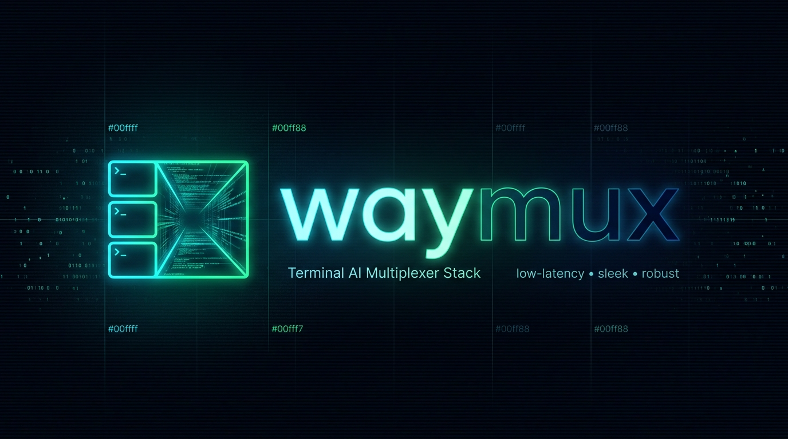

<div align="center">



# Waymux

### Autonomous Terminal AI Cockpit & Control Plane Daemon
**Sub-1.5ms CLI Fast-Path · Zero Status-Bar Polling · Biomechanical Keyboard Ergonomics ($H=0$)**

[](https://github.com/felipecm-br/waymux/releases)
[](https://scorecard.dev/viewer/?uri=github.com/felipecm-br/waymux)
[](LICENSE)
[-7209b7?style=flat-square)](#platform-support)

</div>

---

## ⚡ Why Waymux? (The Problem & The Solution)

Running multiple autonomous AI coding agents (`agy`, `claude`, `codex`, `opencode`, `crush`, `devin`) inside Tmux typically degrades terminal ergonomics:
1. **Status Bar Flicker & Polling Drain**: Rapid tool chaining causes 10+ state flips per second, while `status-interval 1` polling scripts drain CPU and battery when idle.
2. **Cold-Start Hook & Shell Latency**: Spawning Node.js or Python scripts on every `PreToolUse` / `PostToolUse` hook adds 40–60ms of latency per tool call, and `/proc` shell loops (`ps` + `awk` + `jq`) take 140ms+ to render window pickers.
3. **Disjointed Code Review & Worktree Contexts**: Sending inline diff review notes from Git TUIs (`lazygitrs`) into an active agent pane without tearing multi-line markdown, or managing 1-worktree-per-session sandboxes, usually requires fragile shell glue.

**Waymux solves all of this in a single ~3 MB Rust binary:**
- **Zero status-bar polling (`status-interval 0`)**: An asynchronous Axum/Tokio daemon (`waymux daemon`) tracks agent states with consolidated 300ms idle debouncing, proactive stall detection (20s hung-agent heuristic), and multi-pane urgency aggregation.
- **<1.5ms Synchronous CLI Fast-Path**: All client subcommands (`cockpit`, `triage`, `hook`, `inject`, `wt`, `dismiss`, `status`, `list`) execute synchronously **before** initializing the Tokio runtime.
- **~17ms Native `/proc` Cockpit HUD**: Scans `/proc/<pid>/stat` and `/proc/<pid>/comm` directly in Rust to render a 12-column TUI fleet dashboard via **Waymaker (`wm`)** with embedded presets and live `delta` side-by-side diffs.
- **Zero-Node Agent Hooks & Bracketed-Paste Injection**: Native `waymux hook {tmux|lazygit}` (~8ms) and `waymux inject` deliver multi-line review notes atomically via `tmux load-buffer` + `paste-buffer -p`.
- **Git Worktree Orchestrator (`waymux wt` / `awt`)**: Provisions sibling `.bare` worktrees, copies untracked `.env*` secrets, and binds 1 worktree to 1 Tmux session, using the bundled `awt-*.sh` helpers.

---

## 🚀 Quick Installation

### 1-Command Zero-Compile Install (Linux & macOS)

```bash
curl -fsSL https://raw.githubusercontent.com/felipecm-br/waymux/main/install.sh | bash
```

The installer downloads the pre-built binary to `~/.local/bin/waymux` (and symlinks `~/.local/bin/acpd`), verifies its SHA-256 checksum (the install stops if the checksum is missing or wrong; `WAYMUX_SKIP_CHECKSUM=1` overrides; `WAYMUX_VERIFY_ATTESTATION=1` also checks the signed build provenance with `gh attestation verify`), installs the tmux plugin and the `awt-*.sh` worktree helpers under `~/.local/share/waymux/`, and enables the user-level systemd service (`waymux.service`).

| Flag | Effect |
| :--- | :--- |
| `--from-source` | Build with cargo instead of downloading a release |
| `--with-stack` | Also build the companion TUIs `wm` ([Waymaker](https://github.com/felipecm-br/waymaker)) and [`lazygitrs`](https://github.com/felipecm-br/lazygitrs) with cargo |
| `--no-systemd` | Skip the systemd unit (start the daemon yourself with `waymux daemon`) |
| `--prefix <dir>` | Install the binary somewhere other than `~/.local/bin` |

### Build from Source (Rust 1.88+)

```bash
git clone https://github.com/felipecm-br/waymux.git
cd waymux
./install.sh --from-source
```

### Check the Setup

```bash
waymux doctor
```

`doctor` checks the daemon, its token, the config file, tmux, git, `wm`, `lazygitrs`, `delta`, `gh`, a sound player, the worktree helpers, your Claude Code hooks, the theme file and (on Linux) whether your installed `waymux.service` lacks settings the shipped unit has, and prints a fix for each gap. It exits 1 only when something required (daemon, config, tmux, git) is missing or broken.

### Platform Support

| Feature | Linux | macOS |
| :--- | :--- | :--- |
| Daemon, hooks, status bar, triage, `inject` | Yes | Yes |
| Sounds | `pw-play`, `paplay` or `aplay` | `afplay` |
| Desktop notifications, Waybar | Yes | No |
| Cockpit CPU/RAM columns and stall detection | Yes (`/proc`) | No |
| systemd service | Yes | No: run `waymux daemon` (or a launchd agent) |

---

## 🛠️ CLI Command Reference

Client commands bypass the async runtime (`--version`, `health`, `list` and `status` run in under 1.5 ms):

| Command | Description |
| :--- | :--- |
| `waymux daemon [--config <file>]` | Start the async JSON-RPC 2.0 & HTTP control plane daemon on `127.0.0.1:4040` |
| `waymux health` | Probe daemon health (`GET /health`) and exit `0` if healthy |
| `waymux status` | Print daemon health and all active AI agent pane states |
| `waymux list` | List active AI agent pane states in TSV format (`pane_id`, `state`, `last_timestamp`) |
| `waymux dismiss [pane_id]` | Dismiss attention/question/permission badge for a pane (used on `pane-focus-in`) |
| `waymux cockpit [--agents]` | Launch the `85% × 75%` AI Fleet & Window Cockpit HUD popup via Waymaker (`wm`) |
| `waymux cockpit-items [--agents]` | Emit prioritized 12-column TSV rows with native `/proc` CPU/RAM telemetry |
| `waymux cockpit-preview <s> <i> <p> [path]` | Render contextual agent metadata card, PR status, review notes, and pane snapshot |
| `waymux cockpit-diff <path> [pane_id]` | Render side-by-side Git diff (`delta` / `bat`) and pending review notes |
| `waymux cockpit-help` | Render telemetry HUD and ergonomic keybinding cheat-sheet |
| `waymux agent-action <act> <st> <pid> [pane]` | Execute guarded agent action (`approve`, `deny`, `prompt`). `approve`/`deny` re-read the daemon's live state and ignore a prompt on screen for less than 400 ms; a risky call (see [Risk rules](#risk-rules)) needs a second `approve` within 3 s; `deny` sends `Esc`; `prompt` goes through the delivery queue |
| `waymux review-notes <count\|list\|send> ...` | Count, list, or atomically send `.git/info/lines.json` review notes to an agent |
| `waymux triage --popup` | Cycle notifying AI agent panes inside an isolated `_popups` overlay |
| `waymux triage --jump` | Jump to the next agent waiting on you (permission → question → error/stalled, oldest first), then to finished work nobody has reviewed, with origin-return memory |
| `waymux quota [--visual\|--popup\|--json\|--badge\|--badge-min\|--recommend\|--refresh]` | Agent quota and the agent a new session should launch: Claude Code's 5h/7d windows, burn rate and projection, plus any agents your providers report (see [Agent quota](#agent-quota)) |
| `waymux launch [--peek\|--pick] [--auto\|--menu\|shell\|<agent> [args]]` | Start an agent CLI in this pane: a Waymaker menu of agent × model rows with their quota, cursor on the recommended row, or that row directly (`--auto`); `--next <choice>` arms the next launch (see [Agent launch](#agent-launch)) |
| `waymux quota statusline` | Claude Code `statusLine` command: records `rate_limits` from stdin and prints model, context and quota in one line |
| `waymux hook <tmux\|lazygit> <Event>` | Zero-Node AI agent lifecycle hook (`PreInvocation`, `PreToolUse`, `PostToolUse`, `Stop`, `SessionEnd`) |
| `waymux inject <workspace_dir> <prompt>` | Send a multi-line prompt to the workspace's agent pane through the delivery queue |
| `waymux checkpoint <list\|diff <n>\|restore <n> [--force]> [-w <pane>]` | List what each agent turn left in the pane's work tree, show what turn `n` changed, or put the files back as it left them (see [Turn checkpoints](#turn-checkpoints)) |
| `waymux queue <add <pane> <text>\|ls [pane]\|rm <pane> [id]>` | Add, list or drop prompts the daemon holds until the agent is at rest (see [Delivery queue](#delivery-queue)) |
| `waymux phone-token [--rotate] [--url]` | Print the phone page's token, the link that pairs a phone, or replace it to unpair every phone (see [Phone](#phone)) |
| `waymux phone-alert` | Send a test alert to the `[phone]` ntfy topic |
| `waymux wt <subcommand>` | Git worktree orchestrator (`-c`/`new`, `<branch>`, `rm`, `rebase`, `ship`, `pr`, `clone`, `sweep`, `reap`, `popup`; `wt --help`) |
| `waymux init <--tmux\|--systemd\|--hooks>` | Print the tmux plugin line, the systemd unit, or a Claude Code hooks block |
| `waymux doctor` | Check the setup and print a fix for each gap |
| `waymux icon <name>` / `waymux icon --state <state>` | Print one glyph from the icon registry (exit 1 when unknown) |
| `waymux icons [--format tsv\|sh\|tmux]` | Export the icon registry: TSV, `ICON_*` assignments to `eval`, or the `icons:` section for tmux-nerd-font-window-name |

Every command accepts `--help`. Unknown commands exit `2` instead of starting the daemon. `cockpit-items`, `cockpit-preview`, `cockpit-diff`, `cockpit-help`, `agent-action`, `window-create` and `window-delete` are plumbing called by the Cockpit preset and tmux bindings.

---

## ⌨️ Tmux & AI Hook Integration

### 1. Load Plugin in `~/.tmux.conf`

```tmux
run-shell "~/.local/share/waymux/tmux/waymux.tmux"
```

Or bind directly:

```tmux
set -g status-interval 0
set-hook -g pane-focus-in 'run-shell -b "waymux dismiss #{pane_id} >/dev/null 2>&1 || true"'

bind-key Space if-shell -F '#{==:#{session_name},_popups}' 'detach-client' 'run-shell "waymux cockpit"'
bind-key "i"   if-shell -F '#{==:#{session_name},_popups}' 'detach-client' 'run-shell "waymux triage --popup"'
bind-key "I"   run-shell "waymux triage --jump"
bind-key -n 'C-S-i' run-shell "waymux triage --jump"
```

### 2. Agent Hooks

Print the Claude Code hook block and merge it into `~/.claude/settings.json`:

```bash
waymux init --hooks
```

It wires `SessionStart`, `UserPromptSubmit`, `PreToolUse`, `PostToolUse`, `Notification` (permission prompts and questions), `Stop` and `SessionEnd` to `waymux hook tmux <Event>`, plus `waymux hook lazygit <Event>` to link review notes to the session. Other agents call the same commands from their own hook config (Antigravity: `~/.gemini/antigravity-cli/hooks.json`, Devin: `~/.config/devin/config.json`). `waymux doctor` confirms the Claude Code wiring.

`SessionStart` leaves the pane `idle` (a fresh session waits at the prompt; `compact` is left untouched) and `UserPromptSubmit` starts the spinner. The window icon follows the agent binary running in the pane, so the agent named in the hook command only applies to unrecognized commands. Devin imports `~/.claude/settings.json` and runs Claude's hooks next to its own; state updates are idempotent and sounds fire only on transitions, so the duplicates are harmless.

---

## 🏛️ Architecture & Ecosystem


---

## 🔌 JSON-RPC 2.0 Control Plane (`127.0.0.1:4040`)

`waymux daemon` runs out-of-the-box with built-in defaults (`127.0.0.1:4040`, 300ms idle debounce) and optionally loads `~/.config/waymux/config.toml`. Client subcommands (`hook`, `cockpit-items`, `triage`, `status`, ...) talk to port `4040` unless `WAYMUX_PORT` is set, e.g. to drive a second, sandboxed daemon in tests.

Protected endpoints authenticate via local Bearer token stored at `$XDG_RUNTIME_DIR/waymux/token` (`0600` permissions):

- **`POST /rpc`**: JSON-RPC 2.0 endpoint supporting:
  - `agentState/update`, `agentState/list`, `agentState/dismiss`, `agentState/wait`
  - `tmux.new_window`, `tmux.select_window`, `tmux.kill_window`, `tmux.list_windows`
  - `tmux.split_pane`, `tmux.select_pane`, `tmux.kill_pane`, `tmux.list_panes`, `tmux.capture_pane`, `tmux.send_keys`, `tmux.select_layout`
  - `tmux.new_session`, `tmux.kill_session`, `tmux.list_sessions`
  - `tmux.display_message`, `tmux.ring_bell`

  Requests follow JSON-RPC 2.0: numeric or string `id`, notifications (no `id`, HTTP 204), batches, and spec error codes (`-32700` parse error, `-32600` invalid request, `-32601` unknown method, `-32602` invalid params, `-32000` tmux failure).
- **Delivery queue** (`queue/push`, `queue/list`, `queue/cancel`): see below.
- **Held approvals** (`approval/hold`, `approval/get`, `approval/answer`): see [Held approvals](#held-approvals).
- **`agent/recap`** (`{pane_id}`): what the agent did since its pane was last focused (see [Away recap](#away-recap)). `agentState/list` reports `queued` and `changed_at` (epoch ms the pane entered its state) per pane.
- **`POST /api/status`**: REST endpoint for direct agent state updates (`working`, `idle`, `awaiting_input`, `question`, `permission`, `stalled`, `error`, `closed`).
- **`GET /health` & `GET /ready`**: Liveness and readiness probes.

### Risk rules

`y` in the Cockpit allows a shell call matching a risk rule only on a second press within 3 s, for the same prompt; the first press says which rule matched, and the preview shows a red `󰳌 risky:` line. The rules (a speed bump, not a sandbox: the harness's permission system stays the boundary) are recursive delete (`rm` with `-r` and `-f` in any form), force push (`--force`, `-f`, `--force-with-lease`, `+refspec`), `git reset --hard`, `git clean -f`, discard changes (`git checkout .`, `git checkout -- .`, `git restore .`) and pipe to shell (`curl`/`wget` piped to a shell, an interpreter or `sudo`, or run through `bash <(curl …)`, `sh -c "$(curl …)"`, `eval`, `source`). Every command of the call is checked: it is split on `;`, `&&`, `||`, `|`, `&`, newlines and subshells, and followed into `$( )`, backticks, `<( )`, `sh -c` and `eval`, past `sudo`, `env`, `timeout`, `xargs` and `VAR=value`. The hook keeps the call's full command (`$XDG_RUNTIME_DIR/waymux/pane-cmd-*`, `0600`) so a command longer than the one-line reason is still checked.

Answer keys: on Claude Code `y` sends `1` (approve once) and `n` sends `Esc`. `y` and `n` are not hotkeys there and its highlighted option is "1. Yes", so the former `n` + `Enter` approved the call (verified on Claude Code 2.1.310). Other harnesses get `y` + `Enter` and `Esc`.

### Turn checkpoints

At the end of every agent turn (`working` → `idle`, `permission` or `question`) the daemon saves the pane's work tree: tracked files as they are on disk and untracked files git does not ignore (an untracked file over 50 MB is left out), with `HEAD` as parent. A turn that changed nothing gets no checkpoint; each pane keeps the newest 50 (`[checkpoints] keep`, 1 to 1000; `enabled = false` turns them off).

```bash
waymux checkpoint list              # one row per saved turn of this pane ($TMUX_PANE), or -w %12
waymux checkpoint diff 2            # what turn 2 changed
waymux checkpoint restore 1         # files back as turn 1 left them; prints how to undo
```

Checkpoints never touch your repository: they live in a bare store per repository (`$XDG_STATE_HOME/waymux/checkpoints/<name>-<hash>.git`) that reads your objects through `objects/info/alternates` and writes only its own, through a temporary index. No refs are added to your repository, so `git log --all` and lazygitrs's graph stay as they are, and your index, `HEAD`, branch and stash are left alone. `restore` first saves the work tree as a safety checkpoint (or reuses the latest when nothing changed), writes the files that differ, removes the files the checkpoint does not have, and leaves ignored files, the index and `HEAD` untouched; `git status` then shows the restored files as changes. It refuses while the agent is working or on a prompt unless `--force`. Objects your repository later drops (a rewritten history plus `git gc`) can make an old checkpoint unrestorable.

### Held approvals

With `[approvals] enabled = true` in `config.toml` (`hold_seconds`, 10 to 300, default 120) and the `PermissionRequest` hook registered (`waymux init --hooks` prints it with `"timeout": 310`), Claude Code's permission prompt is also held by the daemon, and the Cockpit's `y`/`n` answer it through the hook's own decision output: no keystroke reaches the pane. Claude Code keeps showing its dialog meanwhile (verified on 2.1.310), and the first answer wins: answering in the pane moves it to `working`, which releases the hold.

- Only calls whose whole effect fits one line are held: `Bash` (not with `dangerouslyDisableSandbox`), `Read`, `Glob`/`Grep` without `path`, `WebFetch`, `WebSearch`, on one line of at most 200 characters with no control or invisible characters and no doubled spaces. Everything else is answered in the pane.
- An answer must name the held prompt (`id` and `line`), come at least 400 ms after it was held, and, to allow a call matching a [risk rule](#risk-rules), carry the rules it matched (`risk_ack`), which the Cockpit sends on the second `y`.
- A hold ends with no decision, and the hook prints nothing, when the hold time passes, the pane is focused, leaves the prompt or closes, a newer prompt from the pane arrives, or the daemon stops. Any failure prints nothing, which Claude Code reads as "ask the user": a failure never approves.
- Limit: any process running as you can read the daemon token, so an agent allowed to run `curl` or `waymux` unprompted could answer its own prompt, as it could already type into its pane with `tmux send-keys`. Claude Code's permission rules stay the boundary.

### Away recap

The daemon counts, per pane, finished turns (working for at least 5 s, then idle), files edited (`Edit`, `Write`, ...), shell commands and the last test command (`cargo test`, `pytest`, `go test`, ...), from the hook's tool summaries. Focusing the pane (`pane-focus-in` → `waymux dismiss`) starts the count again. Once you have been away from a pane for 10 minutes, the Cockpit preview opens with one muted line: `󰋚 Since you last looked (42m): 3 turns · 6 files: retry.rs, retry_test.rs +4 · 11 commands · tests: cargo test`.

### Alert bursts

Blocking alerts (permission, question, stalled, error) within 1.5 s of each other play one sound, and status-bar alerts within 2 s share one line (`3 agents need you › 3:api, 4:web and 5:docs`). A line is cleared by the timer of its latest alert only.

### Delivery queue

`inject`, `review-notes send` and the Cockpit's `I` never type into an agent directly. Typed mid-turn, a prompt lands inside the turn; typed while the agent waits on a permission prompt, the paste and its `Enter` answer the prompt. The daemon holds each prompt and types it when:

- the pane is `idle` from the agent itself (a pane with no agent state is typed into at once, as before; the `idle` that focusing a pane sets to clear a prompt badge does not count, since the agent may still be on its prompt), and
- it has stayed idle, with no state change, for 1 s, so a flicker to idle between two tool calls does not count, and
- the previous prompt was taken: one prompt per rest.

A typed prompt stays at the head until the pane shows `working`. One the agent does not take within 5 s is marked `stalled`, never typed again, and announced with a tmux message; it holds the prompts behind it until the pane next works or `waymux queue rm <pane> <id>` drops it. A queue holds 8 prompts of at most 16 KiB each (`queue_full`, `too_large`), lives in daemon memory only, and is dropped when the pane closes.

Before queuing, invisible characters (Unicode tags, bidi controls, zero-width spaces) are removed, and a prompt over 12 KB is written to `$XDG_RUNTIME_DIR/waymux/paste/` (`0600`, removed after 24 h) and replaced by `[Pasted text: <path>, N lines]` for the agent to read. Without a daemon, the prompt is typed directly unless the hook last saw the agent working or on a prompt.

### Phone

The daemon serves a page at `/m` for a phone on your tailnet: every agent with its state, age and recap, held prompts first, answered with **Allow** or **Deny** (a call matching a [risk rule](#risk-rules) asks to confirm). Serve the daemon with `tailscale serve --bg 4040`, then open the link `waymux phone-token --url` prints. The page reads its token from the URL fragment, which a browser never sends to a server, and keeps it in local storage. A phone token reaches `phone/snapshot` and `approval/answer` only (403 otherwise); it is saved `0600` in `$XDG_STATE_HOME/waymux/phone-token`, and `waymux phone-token --rotate` unpairs every phone.

With an [ntfy](https://ntfy.sh) topic in `[phone]`, a prompt still held after `alert_after_seconds` (5 to 120, default 15), so one you did not answer at the desk, sends an alert that names the window (`api:2 build waits for you`, plus `(risky call)` when a rule matched) and opens `/m` when tapped:

```toml
[phone]
ntfy = "https://ntfy.sh/waymux-<random>"   # subscribe to the same topic in the ntfy app
# alert_after_seconds = 15
# url = "https://host.tailnet.ts.net/m"    # default: this machine's Tailscale name
```

The alert never carries the command: it passes through the ntfy server, and anyone who knows the topic can read it, so pick a long random name (`openssl rand -hex 12`) or run ntfy on your tailnet. When the config lives in a public repository, set `ntfy_file = "~/.local/state/waymux/ntfy-topic"` instead of `ntfy`: the first line of that file is the topic URL, read at each alert. `waymux phone-alert` sends a test alert. The topic URL reaches `curl` on stdin, not in its arguments. One alert per held prompt; none when the hold ends first.

---

## ⚙️ Configuration & Environment

The daemon reads `~/.config/waymux/config.toml` when present (see [`config/default.toml`](config/default.toml)); everything has a built-in default.

**Icon registry.** `[icons]` maps program/agent names to Nerd Font glyphs (`devin = ""`, `agent` is the generic fallback) and `[theme.states.<state>].icon` sets the state glyphs. Both merge over built-in defaults. waymux uses them for the window rename, the Cockpit, state badges and alert bells. `waymux icon` and `waymux icons` hand the same registry to shell scripts and tmux plugins, so an icon is defined once.

**Reloading.** `systemctl --user reload waymux` (or `kill -HUP`) re-reads the config without dropping agent state: theme, spinner, sounds, `idle_debounce_ms` and `flow_log_hook` change at once (running spinners keep their frames until the window next starts one). A config that fails to parse is logged and the running one kept. `listen_addr`, `port`, `pid_file` and `log_level` need a restart.

**Logging.** `log_level` sets the daemon's log filter: a level (`debug`) or a full `tracing` directive (`waymux=debug,axum=warn`). `RUST_LOG` overrides it.

**Agent quota.** <a id="agent-quota"></a>`waymux quota` reports how much quota each agent CLI has left and recommends the one a new session should launch. Claude Code is built in: set its `statusLine` command to `waymux quota statusline`, and every refresh records the `rate_limits` it receives (`$XDG_STATE_HOME/waymux/quota/`), from which come the burn rate in %/h, the projection at the 5h reset and the weekly pace. Other agents come from providers: commands that print a JSON array of agent objects with at least `agent`, `available` and `level` (`green`, `yellow`, `red`, `unknown`); optional fields (`title`, `icon`, `tag`, `sessions`, `prompts_1h`, `prompts_5h`, `activity`, `until`, `groups`, `est_five`, `capacity_5h`, `window`, `default_model`, `notes`) shape the report, and every field reaches `--json` unchanged (the module doc in `src/quota/mod.rs` describes each). A provider gets `WAYMUX_QUOTA_NOW`, `WAYMUX_QUOTA_STATE_DIR` and, on `--refresh`, `WAYMUX_QUOTA_FORCE=1`; one that fails or prints anything else is skipped. `--refresh` (silent, one at a time) rewrites the `badge` and `badge-min` caches, for a timer and a status bar that must never wait. In tmux, `--popup` opens the visual report with `Enter` (run `launch`), `a` (run `pick`), `r` (refresh) and `Esc`.

```toml
[quota]
providers = ["~/bin/my-agent-quota"]     # each prints a JSON array of agents
preference = ["claude", "my-agent"]      # launch order; default: claude, then the providers' agents
session_rate = 10                        # %/h one new Claude session burns before samples exist
launch = 'exec "$WAYMUX_QUOTA_AGENT"'    # popup Enter, in a new window (the default)
pick = "my-launcher --pick"              # popup a: prints the command line to run (optional)
```

**Agent launch.** <a id="agent-launch"></a>`waymux launch` starts an agent CLI in the current pane, for a new session's startup command or a launcher popup. Its menu has one row per agent × model with that agent's quota: Claude Code's `claude_models`, the `launch` rows a quota provider attaches to its agents (`[{args, model, tier, quota, level, rec}]`, `rec` marking the model to start when that agent is recommended), and each installed `extra` CLI. The cursor starts on the recommended row, which `--auto` (and any launch without a terminal) starts directly. Without an argument the choice is an armed one (`--next`, valid 30 s, for a picker that creates the pane), else `default`, else the menu. `--peek` prints what would start; `--pick` shows the menu and prints the pick. The pane option `@ai_launch` records the start command so `cockpit restore` can repeat it. `rows_filter` rewrites the rows (JSON array in and out), and `exec` starts the pick as `<exec> <agent> [args...]`, e.g. inside a sandbox.

```toml
[launch]
default = "menu"                             # or auto, shell, an agent
claude_models = ["opus", "sonnet", "haiku"]  # Claude Code --model aliases offered as rows
extra = ["devin", "codex"]                   # CLIs without quota data, shown when installed
exec = "~/bin/start-agent"                   # optional: run as <exec> <agent> [args...]
rows_filter = "~/bin/launch-rows"            # optional: JSON rows on stdin, JSON rows on stdout
```

**Flow events & key telemetry.** `flow_log_hook = "~/bin/flow-log.sh"` runs that program as `<hook> <event> <pane> <extra>` whenever an agent asks a question (`agent_question`), you reply (`human_reply`) or a working agent finishes (`agent_finished`), e.g. to keep a focus or time-tracking log. `keylog = true` makes `waymux keylog` append Cockpit and wrapped tmux key presses to `$XDG_STATE_HOME/flow/keys.tsv`. Both are off unless configured.

| Variable | Default | Purpose |
| :--- | :--- | :--- |
| `WAYMUX_PORT` | `4040` | Port the client commands talk to (e.g. a sandboxed second daemon) |
| `WAYMUX_COLORS` | unset | Theme `colors.toml`; else `~/.config/waymux/colors.toml`, then Omarchy's active theme, then built-in colors |
| `WAYMUX_KEYLOG` | unset | `1` enables `waymux keylog` (`$XDG_STATE_HOME/flow/keys.tsv`) without `keylog = true` in `config.toml`; `0` disables it even when the config turns it on |
| `WAYMUX_REVIEW_MIN_SECS` | `20` | Seconds in lazygitrs (Cockpit `g`) that clear the done-not-reviewed state when nothing was staged, committed or discarded |
| `WAYMUX_LAUNCH_DEFAULT`, `WAYMUX_LAUNCH_EXEC`, `WAYMUX_LAUNCH_FILTER` | unset | Replace `[launch] default`, `exec` and `rows_filter` |
| `WAYMUX_LAUNCH_NEXT` | `$XDG_RUNTIME_DIR/waymux/launch.next` | File `launch --next` arms |
| `WAYMUX_LAUNCH_PRESET`, `WAYMUX_LAUNCH_PICK_PRESET` | built-in | Waymaker preset for the menu, and one layered over it for `--pick` |
| `WAYMUX_QUOTA_PROVIDERS` | unset | Quota providers, one command per line; replaces `[quota] providers` |
| `WAYMUX_QUOTA_PREFERENCE` | unset | Space-separated launch order; replaces `[quota] preference` |
| `WAYMUX_QUOTA_SESSION_RATE` | `10` | Replaces `[quota] session_rate` |
| `WAYMUX_QUOTA_STATE_DIR` | `$XDG_STATE_HOME/waymux/quota` | Claude samples and the badge caches |
| `CLAUDE_CONFIG_DIR` | `~/.claude` | Where `quota` reads Claude Code's sessions and prompt history |
| `WAYMUX_SHARE_DIR` | `~/.local/share/waymux` | Where `install.sh` puts the tmux plugin and `scripts/`, and where `wt` looks for bundled helpers |
| `AWT_SWEEP_ROOTS` | `~/.dotfiles:~/dev/github` | Directories `awt sweep --all` scans (each a repository or a folder of repositories) |
| `AWT_SWEEP_KEEP_BRANCHES` | your user name | Branches whose `target/` `awt sweep --clean-targets` never removes |
| `@border_gradient` (tmux option) | unset | Waymaker gradient palette (preset such as `aurora` or `#rrggbb,#rrggbb,...`) for the Cockpit popup: it opens borderless and Waymaker draws a gradient frame |
| `WAYMUX_SKIP_CHECKSUM` | `0` | `1` lets `install.sh` proceed without a published checksum |
| `WAYMUX_VERIFY_ATTESTATION` | `0` | `1` makes `install.sh` also verify each archive's build provenance (needs a logged-in `gh`; releases from v0.2.4 on) |

Helpers in `~/.config/waymaker/scripts/` override the bundled `awt-*.sh` scripts, so you can customize the worktree flow without forking.

Four optional extension scripts are not bundled and are looked up in the same helper directories, then in `~/.config/tmux/`: `awt-popup.sh` (`waymux wt popup` and the Cockpit's worktree switcher; `wt popup` exits 127 without it), `session-picker.sh` (the Cockpit's session switcher), `record-window-state.sh` (run as `--push <session:window>` before the Cockpit kills a window) and `flow-telemetry.py` (run with `--hud` above the Cockpit help).

## 🩺 Troubleshooting

| Symptom | Check |
| :--- | :--- |
| Status bar never changes | `waymux doctor` (daemon and hooks rows); `waymux list` should show your pane while the agent works |
| `waymux cockpit` does nothing | `wm` must be on `PATH` (`./install.sh --with-stack`) |
| `waymux wt ...` prints "awt-*.sh not found" | Rerun `install.sh` to restore `~/.local/share/waymux/scripts` |
| No sound | `doctor`'s sound row; set `[sound] player = "..."` in the config to force one |
| `daemon already running` | Another daemon holds `$XDG_RUNTIME_DIR/waymux/waymux.pid`: `systemctl --user restart waymux` |

## 🧪 Development & Verification

```bash
# Format, lint (zero warnings), and run the unit and integration tests
cargo fmt --all -- --check
cargo clippy --all-targets --all-features -- -D warnings
cargo test

# Rebuild release binary and restart user systemd service
./scripts/update-daemon.sh
```

### 🐳 Isolated Docker Sandbox

Test the complete Waymux stack (`waymux` daemon, Tmux 3.8 status badges, `wm` Cockpit HUD, `lazygitrs`, inline review notes, and simulated `claude`/`codex`/`opencode` agents) inside a clean container without touching your host Tmux server:

```bash
# Run the automated 8-step end-to-end integration test suite (also runs in CI)
just docker-test

# Launch an interactive Tmux session pre-populated with simulated AI agents & Git diffs
just docker-demo

# Inside the sandbox Tmux session:
#   • Prefix + Space   Open Waymux Cockpit HUD
#   • Prefix + i       Open Alert Triage Popup
#   • Prefix + I       Jump directly to next alerting AI agent
#   • Ctrl + G         Open Lazygitrs side-by-side diff & review notes
#   • scenario cycle   Transition simulated agents across permission/question/idle states
#   • scenario status  Inspect daemon health and Tmux window badges
```

See [AGENTS.md](AGENTS.md) for architecture and module conventions, [CONTRIBUTING.md](CONTRIBUTING.md) for pull request guidelines, and [CHANGELOG.md](CHANGELOG.md) for release history.

## 🔒 Security

Report vulnerabilities privately, as described in [`SECURITY.md`](SECURITY.md).

## 📜 License

MIT © [Felipe Miranda](LICENSE)
