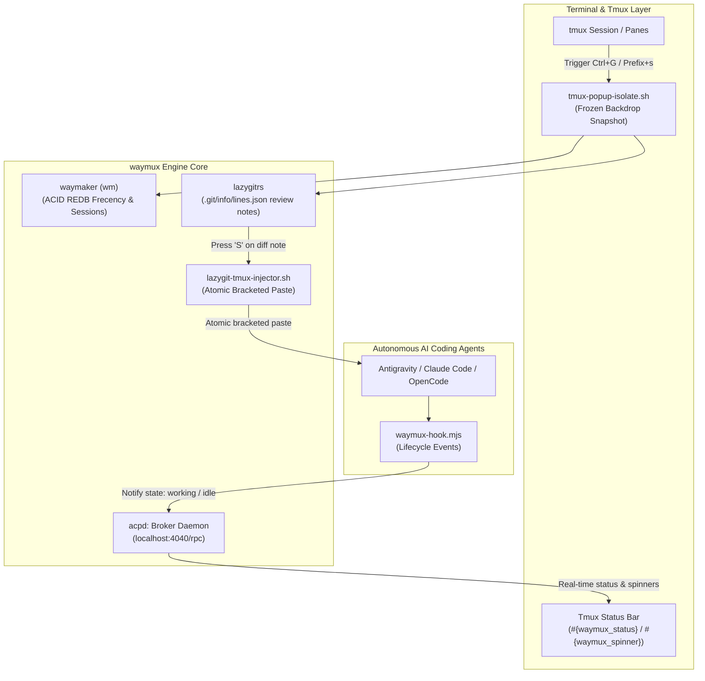

<div align="center">


# waymux

### The Terminal AI Multiplexer Stack
**Sub-100ms Latency · Zero Redraw Flicker · Biomechanical Keyboard Ergonomics**

[](https://github.com/fcmiranda/waymux/releases)
[](LICENSE)
[](#)

</div>

---

## ⚡ The Problem

When running autonomous AI coding agents (Antigravity, Claude Code, OpenCode, Codex) inside terminal multiplexers:
1. **Redraw Corruption & Screen Tearing:** Rapid token streaming destroys the visual integrity of modal popups. Redrawing windows while LLM tokens flood the PTY causes popups to flicker, tear, and drop keystrokes.
2. **Context Switching Friction:** Jumping between git diffs, project workspaces, and active agent panes involves cognitive overload and chorded hotkeys ($H > 0$).
3. **Review Note Spaghetti:** Reviewing code generated by agents requires manual copy-pasting between diff tools and chat prompts, risking out-of-order execution and lost formatting.

**`waymux`** solves this by providing a unified, pre-calibrated stack that integrates an async broker daemon, a sub-millisecond workspace engine, a specialized review TUI, and hardened frozen ANSI backdrops.

---

## 🚀 Quick Install (Zero Compilation)

Install the entire pre-compiled stack in under 5 seconds:

```bash
curl -fsSL https://raw.githubusercontent.com/fcmiranda/waymux/main/install.sh | bash
```

> **Zero Compilation Guarantee:** Downloads static multi-arch binaries (`x86_64` and `aarch64` musl/Darwin). No toolchains or package compilation required.

### Activate in Tmux

Add this line to your `~/.tmux.conf`:

```tmux
run-shell "~/.local/share/waymux/tmux/waymux.tmux"
```

---

## 🧩 The Core Engines (Tier 1)

`waymux` unifies three high-performance engines into a seamless developer experience:

| Component | Engine | Role |
| :--- | :--- | :--- |
| **Broker Daemon** | [`acpd`](https://github.com/fcmiranda/acpd) | Async JSON-RPC daemon tracking multi-pane agent lifecycle states, live spinners, and audio cues without PTY tearing. |
| **Workspace & Sessions** | [`waymaker`](https://github.com/fcmiranda/waymaker) (`wm`) | Sub-millisecond Nucleo fuzzy finder, previewer, and native workspace/session manager. Eliminates external Go `sesh` and `zoxide`. |
| **Review Engine** | [`lazygitrs`](https://github.com/fcmiranda/lazygitrs) | Blazing-fast Git TUI with `--commits`, worktree port discovery, and inline diff review comments injected directly into active AI panes via bracketed paste. |
| **Isolator Layer** | `scripts/tmux-popup-isolate.sh` | Freezes terminal backdrops during active streaming so popups never flicker or redraw-corrupt. |

---

## ⌨️ Biomechanical Keybindings Matrix

Designed around the **Home Row First ($H=0$)** principle:

| Keybinding | Scope | Action | Engine |
| :--- | :--- | :--- | :--- |
| **`Ctrl + G`** | Global (Root) | **Inline Diff Review & AI Dispatch:** Opens full-screen diff. Press `S` to bracket-paste multi-line review notes straight to the active AI pane. | `lazygitrs` |
| **`Prefix + s`** | Tmux Prefix | **Workspace & Session Switcher:** Instant picker with frecency scoring, worktree detection, and live directory previews. | `waymaker` |
| **`Prefix + C-j`** | Tmux Prefix | **Jump to Last Session:** Toggle back to previous project in zero milliseconds. | `waymaker` |

---

## 🏛️ Architecture



---

## 🔒 Clean Repository Guarantee

Unlike traditional tools that pollute project root folders with `.lines.json` or `.state.json`, `waymux` persists all review notes into `<git_dir>/info/lines.json` (inside `.git/`, which Git ignores natively) and automatically configures a global gitignore fallback, guaranteeing user working trees remain 100% pristine.

---

## 📜 License

MIT © [Felipe Miranda](LICENSE)
